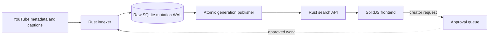

# ytsearch

[](https://github.com/Priyansh4444/ytsearch/actions/workflows/ci.yml)
[](LICENSE)

Self-hosted YouTube transcript search that turns caption matches into
timestamped moments.

[Try the live app](https://search.pronsh.dev) ·
[Self-host ytsearch](docs/self-hosting.md) ·
[Contribute](CONTRIBUTING.md)

- Search titles and transcripts, with timestamped matches grouped per video and
  an optional creator filter.
- Index public captions with `yt-dlp`; the YouTube Data API is an optional
  metadata fallback (it does not provide captions).
- Creator requests wait for operator approval before one queue worker indexes
  them without touching existing data.
- Public search credentials stay separate from trusted indexing credentials.

The search backend is the Raw inverted index. The API and indexer are Rust, the
frontend is SolidJS, and a Cloudflare Worker proxies the API and controls
infrastructure.



## Quick start with Docker

Install Docker with Compose and OpenSSL, then run:

```bash
export RAW_SEARCH_ADMIN_API_KEY="$(openssl rand -hex 24)"
export RAW_SEARCH_API_KEY="$(openssl rand -hex 24)"
export YTSEARCH_INDEX_QUEUE_TOKEN="$(openssl rand -hex 24)"
export PUBLIC_API_BASE_URL=http://localhost:8787
docker compose up -d --build
curl -fsS http://localhost:8787/api/health
```

Open `http://localhost:3000`. The index starts empty; add a creator (this also
updates their video and chunk counts):

```bash
docker compose exec worker ytsearch \
  index-youtuber @handle --backend raw --mode update --jobs 1
```

Read the [self-hosting guide](docs/self-hosting.md) before exposing it publicly.

## Local development

Install Rust stable, [Bun](https://bun.sh/) (the version pinned by
`packageManager` in `package.json`), Docker with Compose, and `yt-dlp`. Then:

```bash
bun run setup                                 # locked deps and a private .env
docker compose up -d raw-search init-backend  # the Raw engine
bun run api                                   # Rust API on 127.0.0.1:8787
bun run dev                                   # frontend on localhost:3000
```

Setup never replaces an existing `.env`, and ordinary development needs no Fly,
Cloudflare, Axiom or YouTube credentials. If setup fails, its error names the
missing tool; rerun it after installing that tool.

Indexing, queue review, rewipe and repair are covered in the
[indexing operations guide](docs/indexing-operations-guide.md).

## Configuration and privacy

[`.env.example`](.env.example) documents every setting. Never put secrets in
`VITE_*` variables, which are embedded in the browser bundle, and keep cookie
exports outside the repository. Frontend analytics are off unless
`VITE_POSTHOG_KEY` is set.

You are responsible for complying with YouTube's terms, applicable law, and the
rights of creators whose content you process. Do not use cookies or local
transcription to bypass access controls. Review the
[privacy and compliance notice](docs/privacy-notice.md) before running a public
service.

## Checks

```bash
bun run check:precommit   # fast gate, also run by `bun run hooks:install`
bun run check             # the full CI suite
```

## Documentation

- [Architecture](docs/architecture.md): crates, boundaries and data flow
- [Self-hosting](docs/self-hosting.md): deployment, persistence and cookies
- [Indexing operations](docs/indexing-operations-guide.md): queue and repair
- [Deployment](docs/deploy.md): the maintained Fly and Cloudflare setup
- [Staging observability](docs/staging-observability.md): health checks and logs
- [Capacity](docs/capacity.md): measured load, limits and what to change as it grows
- [Playbooks](docs/playbooks/README.md): performance, dependency and frontend
  work

ytsearch is pre-1.0: APIs, schemas and operations may change. Contributions are
welcome; see [CONTRIBUTING.md](CONTRIBUTING.md), and report vulnerabilities
privately per [SECURITY.md](SECURITY.md). Code and docs are MIT licensed; the
license grants no rights to third-party YouTube content or data.
