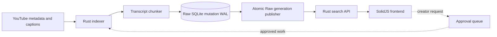

# ytsearch

[](https://github.com/Priyansh4444/ytsearch/actions/workflows/ci.yml)
[](LICENSE)

Self-hosted YouTube transcript search that turns caption matches into
timestamped moments.

[Try the live app](https://search.pronsh.dev) ·
[Self-host ytsearch](docs/self-hosting.md) ·
[Contribute](CONTRIBUTING.md)

## Features

- Search video titles and transcript text, with multiple timestamped matches
  grouped under each video.
- Filter results by creator and open a match at the relevant point on YouTube.
- Index public captions with `yt-dlp`; optionally use the YouTube Data API for
  metadata and discovery fallback.
- Run the complete stack with Docker Compose or deploy each service separately.
- Review creator requests before a single queue worker performs
  non-destructive updates.
- Keep public search credentials separate from trusted indexing credentials.

The supported search backend is the mutable Raw inverted index. The frontend is
SolidJS, the public API and indexer are Rust, and a Cloudflare Worker provides
same-origin API proxying and scheduled infrastructure control.

## How it works



`yt-dlp` is the primary discovery and caption source. `YOUTUBE_API_KEY` is an
optional metadata and discovery fallback; the YouTube Data API does not provide
captions. Optional local transcription is available only for content you are
allowed to process.

## Quick start with Docker

Install Docker with Compose and OpenSSL, then run:

```bash
export RAW_SEARCH_ADMIN_API_KEY="$(openssl rand -hex 24)"
export RAW_SEARCH_API_KEY="$(openssl rand -hex 24)"
export YTSEARCH_INDEX_QUEUE_TOKEN="$(openssl rand -hex 24)"
export PUBLIC_API_BASE_URL=http://localhost:8787
docker compose up -d --build
curl -fsS http://localhost:8787/api/health
```

Open `http://localhost:3000`. The first boot starts an empty index. Add a
creator with a non-destructive update, then publish the resulting counts:

```bash
docker compose exec worker ytsearch \
  index-youtuber @handle --backend raw --mode update --jobs 1
```

Replace `@handle` with a YouTube creator handle. Indexing a full channel can
take time and may be limited by caption availability or YouTube rate limits.
The command prints progress in the terminal.

The Compose deployment persists Raw mutations and generations, the approval queue, and
transcript cache in named volumes. See the
[self-hosting guide](docs/self-hosting.md) before exposing it publicly.

## Local development

Install:

- Rust stable
- [Bun](https://bun.sh/) 1.3.14
- Docker with Compose, or a separately deployed Raw search service
- `yt-dlp`; `ffmpeg` is also required for optional local transcription

Set up a fresh clone with one command:

```bash
bun run setup
```

The setup command installs locked dependencies and creates `.env` with random,
local-only credentials. It never replaces an existing `.env`. You do not need
Fly, Cloudflare, Axiom, or YouTube credentials for ordinary development.

Start Raw and verify its mutable administration service:

```bash
docker compose up -d raw-search init-backend
```

Then start the API and frontend in separate terminals:

```bash
bun run api
```

```bash
bun run dev
```

The frontend runs at `http://localhost:3000` and proxies `/api` to the Rust API
at `http://127.0.0.1:8787`.

If setup fails, its error names the missing prerequisite. You can rerun it
safely after installing that tool.

## Indexing and queue operations

Frontend creator requests wait for operator approval:

```bash
scripts/review-index-requests.sh
```

For direct local indexing:

```bash
cargo run --release -p youtube_cli -- validate @handle
cargo run --release -p youtube_cli -- \
  index-youtuber @handle --backend raw --mode update --jobs 1
```

`update` preserves existing chunks and is the normal mode. Destructive rewipe
is fail-closed and requires both an environment acknowledgement and a CLI flag:

```bash
ALLOW_DESTRUCTIVE_REWIPE=1 cargo run --release -p youtube_cli -- \
  index-youtuber @handle --backend raw --mode rewipe \
  --allow-destructive-rewipe --jobs 1
```

Read the [indexing operations guide](docs/indexing-operations-guide.md) for
queue approval, repair, bulk updates, cookies, and cloud workers.

## Configuration and privacy

The checked-in [`.env.example`](.env.example) documents available settings.
Important secrets include:

- `RAW_SEARCH_ADMIN_API_KEY`
- `RAW_SEARCH_API_KEY`
- `YTSEARCH_INDEX_QUEUE_TOKEN`
- `YOUTUBE_API_KEY`
- `YT_DLP_COOKIES_FILE`
- Cloudflare, Fly, and Axiom credentials

Never put secrets in `VITE_*` variables; Vite embeds them in the browser
bundle. Keep browser cookie exports outside the repository. Frontend analytics
are disabled unless `VITE_POSTHOG_KEY` is set.

You are responsible for complying with YouTube's terms, applicable laws, and
the rights of creators whose content you process. Do not use cookies or local
transcription to bypass access controls. Review the
[privacy and YouTube compliance notice](docs/privacy-notice.md) before running
a public service.

## Development checks

Run the same deterministic suite used by CI:

```bash
bun run check
```

It covers formatting, type-aware linting, TypeScript checks, strict Clippy,
Rust and frontend tests, mocked browser flows, production builds, bundle
budgets, dependency policy, and shell syntax. Useful focused commands:

```bash
bun run test:frontend:watch
bun run test:frontend:coverage
bun run check:responsive
bun audit
bun run hooks:install
```

The deployed-site performance check remains separate:

```bash
bun run perf:frontend
```

## Documentation

- [Architecture](docs/architecture.md) — crates, boundaries, and data flow
- [Self-hosting](docs/self-hosting.md) — deployment, persistence, and cookies
- [Indexing operations](docs/indexing-operations-guide.md) — queue and repair
  procedures
- [Deployment](docs/deploy.md) — the maintained Fly and Cloudflare setup
- [Staging observability](docs/staging-observability.md) — health checks,
  benchmarks, and logs

## Project status

ytsearch is an actively developed pre-1.0 project. APIs, schemas, and
operational workflows may change. The repository includes production-oriented
safety checks, but self-hosters should review the deployment and compliance
guides for their own environment.

Contributions are welcome. Read [CONTRIBUTING.md](CONTRIBUTING.md) for the local
workflow, code map, and test guidance. GitHub provides structured bug and
feature forms, plus a pull request checklist. Report vulnerabilities privately
according to [SECURITY.md](SECURITY.md). Source code and documentation are
available under the [MIT License](LICENSE); the license does not grant rights
to third-party YouTube content or data.
