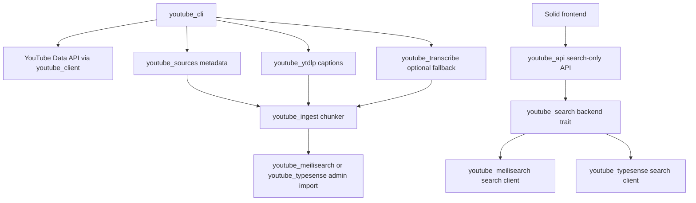

# Architecture

`ytsearch` is split around replaceable boundaries so search, metadata, caption extraction, transcription, chunking, and storage can evolve independently.

## Crates

| Crate | Responsibility | Hotswap boundary |
| --- | --- | --- |
| `youtube_client` | Small typed wrapper around YouTube Data API v3 list endpoints. | Replace if moving to generated OpenAPI clients or another metadata provider. |
| `youtube_sources` | YouTube Data API metadata source plus in-memory/fallback source combinators. | Implements `VideoMetadataSource`; does not know about `yt-dlp`. |
| `youtube_ytdlp` | `yt-dlp` backed public caption transcript source. Parses `json3`/`vtt` into timestamped segments. | Implements `TranscriptSource`; can be replaced by any captions provider. |
| `youtube_transcribe` | Optional local audio fallback using `yt-dlp` audio extraction, `ffmpeg`, `ffprobe`, and `voxtype`. | Implements `TranscriptSource`; use only when captions are missing and you are allowed to transcribe. |
| `youtube_ingest` | Core domain model, ports/traits, and transcript chunker. | Defines `VideoMetadataSource`, `TranscriptSource`, `TranscriptChunkSource`, `ChunkSink`, and `EmbeddingSource`. |
| `youtube_search` | Shared query type, indexed creator document, and search backend trait. | API-facing hotswap boundary for search backends. |
| `youtube_meilisearch` | Meilisearch settings, admin import/delete/upsert, and search client. | Preferred backend for new deployments; implements `ChunkSink` and `TranscriptSearchBackend`. |
| `youtube_typesense` | Typesense schema, admin import/delete/upsert, and search client. | Secondary staging/rollback backend; implements `ChunkSink` and `TranscriptSearchBackend`. |
| `youtube_cli` | Operator CLI for validation, indexing, direct video indexing, and CLI search. | Wires sources/sinks together; no core parsing logic should live here. |
| `youtube_api` | Axum HTTP API for frontend search and indexed channel listing. | Uses `youtube_search::TranscriptSearchBackend`; keep admin actions out of this service. |
| `youtube_jsonl` | Local JSONL chunk persistence helpers. | Useful for offline/debug export. |
| `youtube_semantic` | Experimental embedding/vector-search abstractions. | Keep optional until semantic search is production-ready. |

## Data flow

## Transcript strategy

1. Fetch public captions with `youtube_ytdlp::YtDlpTranscriptSource`.
2. Parse captions into `TranscriptSegment` values.
3. Chunk into searchable windows with `youtube_ingest::Chunker`.
4. Optional fallback: `youtube_transcribe::VoxtypeTranscriptSource` only when captions are unavailable.

## UI structure

The frontend is intentionally split by cognitive load:

- `src/App.tsx` orchestrates route/channel/search state.
- `src/api.ts` owns HTTP calls.
- `src/types.ts` owns frontend API types.
- `src/utils.ts` owns formatting/routing/highlight helpers.
- `src/components/*` owns view components.

Avoid putting new feature logic directly into `App.tsx` unless it is app-level orchestration.
