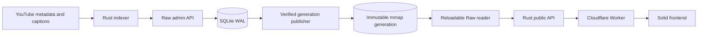

# Architecture

ytsearch separates ingestion, durable mutations, immutable search generations,
the public API, and the browser. Raw is the only supported search backend.

## Runtime data flow

A complete video replacement is one idempotent WAL operation. Publication
streams the base corpus and mutations into a candidate, validates checksums and
opens the candidate, atomically changes the active manifest, then swaps an
`Arc<RawSearchEngine>` behind an `RwLock`. Queries never read a partially built
generation.

## Crates

| Crate | Responsibility |
| --- | --- |
| `youtube_ingest` | Domain models, source traits, and transcript chunking |
| `youtube_client` | Narrow YouTube Data API list client |
| `youtube_sources` | Metadata discovery and fallback composition |
| `youtube_ytdlp` | Public caption and metadata extraction |
| `youtube_transcribe` | Optional permitted local transcription fallback |
| `youtube_time` | RFC 3339 and duration parsing |
| `youtube_index_store` | Backend-neutral mutable search administration contract and Raw HTTP client |
| `youtube_search_client` | Read-only Raw search client and query builder |
| `youtube_search_service` | Authenticated search/admin HTTP transport and bounded caching |
| `youtube_raw_search` | Inverted index, ranking, mutation WAL, publication, recovery, and reloadable reader |
| `youtube_cli` | Validation, channel/video indexing, repair, deletion, and direct search |
| `youtube_api` | Public search, channel directory, and durable approval queue |
| `youtube_semantic` | Opt-in local Qdrant / EmbeddingGemma snapshot pilot binary; outside production ingestion |

## Credential boundary

- Browsers receive no search, admin, queue, Fly, YouTube, or Axiom secret.
- `youtube_api` uses only `RAW_SEARCH_API_KEY` for public reads.
- Indexers use `RAW_SEARCH_ADMIN_API_KEY`; this key never reaches the browser or
  public API response.
- `YTSEARCH_INDEX_QUEUE_TOKEN` protects queue review and acknowledgement.
- The Cloudflare Worker owns Fly lifecycle calls through `FLYIO_TOKEN`.

## Frontend structure

- `src/app.tsx` composes route-level state.
- `src/app-lifecycle.ts` owns availability and navigation lifecycles.
- `src/api.ts` owns request coalescing and the public Promise interface.
- `src/bootstrap-api.ts` owns the small startup transport and runtime wire
  decoders; `src/client-runtime.ts` owns search, queue, dashboard, and clipboard
  operations behind one lazy boundary.
- `src/api-error.ts` keeps transport, HTTP-response, and decoding failures
  distinct without shipping a general effect runtime to the browser.
- `src/search-resource.ts` represents idle, loading, success, and error as one
  discriminated state, preventing contradictory UI flags.
- `src/components/` owns presentation and local interaction.
- `worker/` owns same-origin proxying, queue wakeups, and scheduled Fly control;
  this server-side boundary uses Effect v4 for typed asynchronous workflows.

Solid 2 batches updates through the end of an event. The frontend uses
`flush()` only where a submit or view transition must synchronously observe a
just-written signal. Effects compute from explicit accessors and return cleanup
for abortable work. Initial JavaScript is measured as the complete static import
graph, not only the HTML entry asset.

## Operational invariants

1. One queue file has exactly one active indexer writer.
2. Durable mutations are acknowledged before publication; retries reuse stable
   content-derived idempotency keys.
3. Search stays on the last verified generation if publication fails.
4. The queue is authoritative; Cloudflare Queue messages are only wake signals.
5. Unknown search filters and sorts fail closed.
6. Raw engine and queue volumes are snapshotted and restored independently.
7. Channel deletion scope, publication policy, existing-data policy, indexed
   field, and API relevance ordering are enums internally. Legacy boolean HTTP
   and SQLite representations are converted only at their boundaries.
