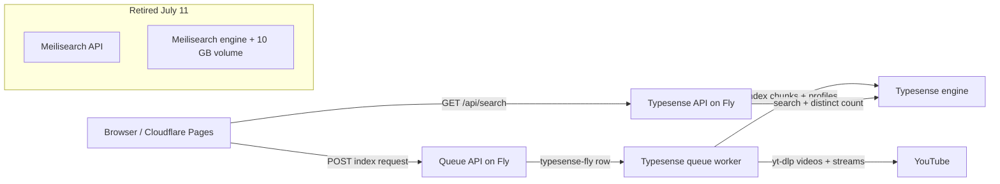
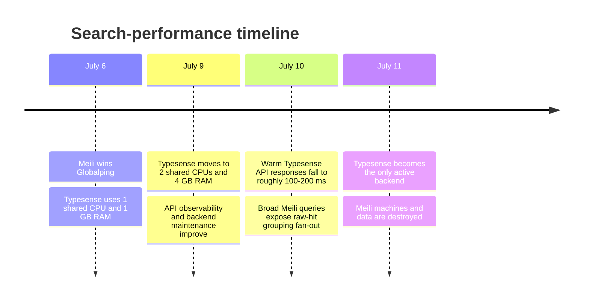
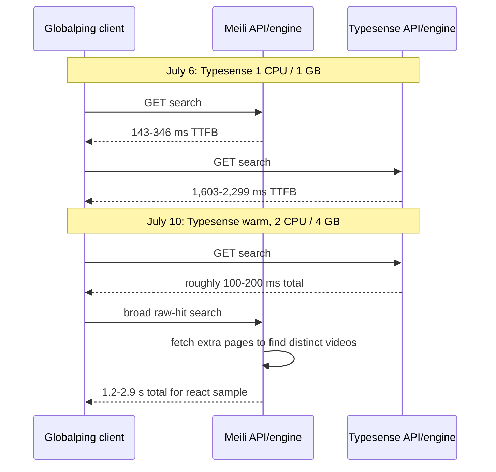

# Search Performance Investigation: July 2026

## Executive Summary

The screenshot's July 6 Globalping run correctly measured Meilisearch as faster
than Typesense for that point in time. It was not a contradiction with the later
Typesense improvement. The largest verified change was infrastructure: Typesense
was upgraded from one shared CPU and 1 GB RAM to two shared CPUs and 4 GB RAM on
July 9. The historical runtime report showed only about 962 MB total memory.

That upgrade is the strongest explanation for the large reduction in Typesense
time-to-first-byte. Warm engine state, API-path changes, and changing index data
also contributed, but none independently prove a backend-engine ranking.



The current critical request path is Browser -> API -> Typesense. The queue and
indexer are deliberately separate from the search path, so sustained indexing
does not add a browser round-trip.

## Evidence Timeline

| Date | Observation | Evidence |
| --- | --- | --- |
| July 6 | Globalping `react` showed Meilisearch 213-433 ms total and Typesense 1,727-2,325 ms total. Typesense TTFB alone was 1,603-2,299 ms. | Historical result in `docs/staging-observability.md`. |
| July 6 | Typesense was provisioned as `shared-cpu-1x`, 1 GB. | `fly.typesense.toml` at commit `0a29ed9`. |
| July 9 | Typesense was changed to `shared-cpu-2x`, 4 GB. | Commit `04e8446` / `fly.typesense.toml`. |
| July 10 | Warm API samples had Typesense around 100-200 ms for broad queries while Meilisearch's `react` path ranged roughly 1.2-2.9 s. | Controlled live run recorded during retirement work. |
| July 11 | Meilisearch engine, API, worker, and 10 GB volume were destroyed after a preservation commit. | `20f53fb` and Fly resource verification. |



## What Made Typesense Faster

### 1. The Typesense VM was severely underprovisioned in the screenshot

Typesense keeps its search structures in memory. At 1 GB, the old engine had
very little space for the resident index, operating-system page cache, and query
work. The historical metrics report shows approximately 962 MB of total memory.
Moving to 4 GB and a second shared CPU removed that constraint. This is the only
change with direct before/after configuration evidence large enough to explain a
multi-second TTFB improvement.

### 2. The later tests used a warm engine

The engine is now configured with one always-on machine. A warm Typesense node
has its in-memory index loaded and avoids first-request disk/page-cache work.
Warmth is a contributor, not the whole explanation: historical notes recorded
slow Typesense results even after a warm check, so the VM sizing change matters.

### 3. The API gained better observability and parallel exact counts

The API now measures first backend search time, total backend time, result
processing time, backend call count, and response bytes. It runs the first
search and distinct-video total in parallel. This makes later measurements much
more diagnosable, but it does not erase backend-page fan-out when a query is
dominated by transcript chunks from one video.

### 4. The Meilisearch path amplified duplicate-hit fan-out

For card results, the API asks the backend for raw transcript hits and groups
them into distinct videos. Broad queries such as `react` can return many chunks
from one video. Meilisearch frequently required additional pages to fill the
visible distinct-video cards; the API's `collect_visible_videos` loop therefore
became the latency bottleneck. This is application-level pagination/grouping
work, not proof that Meilisearch's basic text lookup is intrinsically slow.

### 5. Indexing and corpus state made a strict engine comparison invalid

The two backends had different creator coverage. During one supposedly paused
test, Typesense totals changed because writes already accepted by the engine were
still draining. Different corpus size, document distribution, warm cache state,
and concurrent write pressure all change result count and query cost. The
benchmark scripts now mark an unstable corpus as `corpus_stable=no` and reject
it as a decision-quality comparison.

## Why Meilisearch Appeared Faster in the Screenshot

The screenshot was a valid measurement of the old deployment, not bad data.
At that time Meilisearch had more CPU/RAM than Typesense, Typesense was near its
1 GB memory ceiling, and the old Typesense API path had multi-second TTFB.
Network setup was not the explanation: DNS/TCP/TLS were small for both backends;
the difference was overwhelmingly server time before the first byte.



## Serialization Experiment

The experimental protobuf benchmark encodes the representative transcript-chunk
shape with `prost` and compares it with `serde_json`:

```bash
cargo run -p youtube_serialization_bench --release -- 10000 10
```

July 11 local result:

| Format | Bytes/chunk | Encode ms/10,000 | Decode ms/10,000 |
| --- | ---: | ---: | ---: |
| JSON via Serde | 684.3 | 3.68 | 6.04 |
| Protobuf via Prost | 365.6 | 1.44 | 2.88 |

Protobuf used 53.4% of JSON's bytes, encoded about 2.6x faster, and decoded
about 2.1x faster in this microbenchmark. It does not fix the historical
Typesense TTFB problem: the search engine and public API currently use JSON, and
the major observed bottleneck was engine sizing plus result-grouping fan-out.
Adopt protobuf only after defining versioned public/export schemas and adding
compatibility fixtures.

## Current Decision

Typesense is the only active backend. Meilisearch is a source-level legacy
implementation only; its Fly runtime and indexed data no longer exist. The
retirement record is `docs/legacy/meilisearch-retirement.md`.

## Frontend Hostname

The active frontend is deployed against the Typesense API. The requested hostname
`yt-search.pronsh.pages.dev` cannot currently be attached because
`pronsh.pages.dev` is not a zone or a Pages project domain in this Cloudflare
account. Cloudflare Pages requires either the project's generated `pages.dev`
hostname or a custom hostname under a zone the account controls. Once a zone
such as `pronsh.dev` is available, attach `yt-search.pronsh.dev` through the
Pages custom-domain API and redirect old Pages aliases to it.
