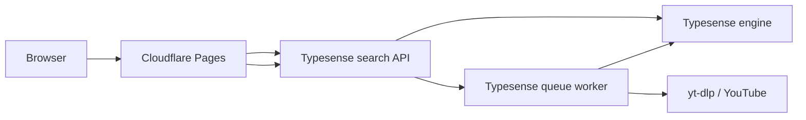

# Staging Architecture

Typesense is the only active search backend. The three always-on Fly Machines
are deliberately separated so indexing load cannot take down public search.

| Fly app | Purpose | Keeps running? |
| --- | --- | --- |
| `ytsearch-api-typesense-fly-staging` | Public search and queue API; owns the JSONL queue volume | Yes |
| `ytsearch-typesense-staging` | Typesense engine and data volume | Yes |
| `ytsearch-indexer-staging` | One Typesense queue/indexing daemon and transcript cache | Yes while the queue or daily update is active |

Cloudflare Pages is outside Fly and serves `https://ytsearch-755.pages.dev`.

## Reliability And Cost Rules

1. Keep exactly one persistent queue worker. JSONL has no distributed lock.
2. The persistent worker uses 4 performance CPUs and 8 GB RAM for sustained
   `yt-dlp` work, a 10 GB encrypted transcript-cache volume, and a one-request
   queue pass to avoid a large creator starving later requests. This sizing is
   required because the `yt-dlp` EJS/Deno helper previously OOM-killed on the
   4 GB shared tier. It deliberately uses `JOBS=1` and `TYPESENSE_JOBS=1`:
   this is write backpressure for the single 4 GB Typesense node, not a limit
   on future horizontally scalable ingestion. One-off workers retain their
   lower-cost defaults.
3. The worker uses `yt-dlp` first. A staged YouTube Data API key is a metadata
   discovery fallback only; it cannot retrieve transcript captions.
4. Public search and Typesense stay warm. Stop the worker only after confirming
   the queue is empty and pausing daily updates; never stop the API or engine
   as a cost-saving measure while the frontend is expected to serve traffic.
5. Update mode preserves existing chunks. Refresh indexed-count documents after
   a completed bulk pass so the frontend's `indexed / public` count stays true.
6. `TYPESENSE_RESET_PEERS_ON_ERROR=true` is enabled only to recover the
   single-node Raft metadata after an unclean failure. It is not high
   availability; investigate and reduce write pressure if it is ever used.

## Operator Surfaces

| Task | Command |
| --- | --- |
| Machine inventory | `scripts/check-staging-machines.sh` |
| Queue-worker invariant | `scripts/check-queue-indexers.sh` |
| Start the worker | `scripts/fly-run-queue-indexers.sh` |
| Per-channel status | `scripts/check-indexed-channel-status.sh @handle` |
| Refresh channel counts | `scripts/refresh-all-backend-counts.sh` |
| Search benchmark | `QUERY=react RUNS=10 scripts/benchmark-search-backends.sh` |

Meilisearch is source-level legacy only. Its Fly engine, API, worker, volume,
and indexed data were destroyed; see `docs/legacy/meilisearch-retirement.md`.
