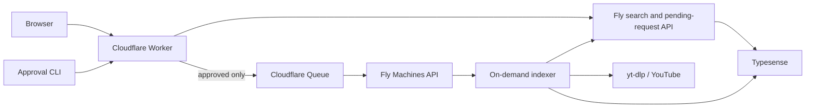

# Production Architecture

Typesense remains the search backend. Cloudflare serves the application and
uses a Queue message to wake the Fly indexer only after an operator approves a
frontend request.

| Service | Purpose | Keeps running? |
| --- | --- | --- |
| Cloudflare Worker | Static application, queue/status proxy, and approved-request wake producer | Yes |
| Cloudflare Queue | Durable, retryable indexer wake signal | Managed |
| `ytsearch-api-typesense-fly-staging` | Public search API and authoritative JSONL request queue | Yes |
| `ytsearch-typesense-staging` | Typesense engine and data volume | 11:45 AM–12:00 AM Pacific, plus indexing overrun |
| `ytsearch-indexer-staging` | Queue/indexing daemon and transcript cache | Only while work is active |

Production is served at `https://search.pronsh.dev`.

## Reliability And Cost Rules

1. The JSONL request log remains authoritative. Cloudflare Queue is only a wake
   signal, so duplicate delivery is harmless and losing an individual signal
   does not lose a request.
2. Keep exactly one configured indexer Machine because JSONL has no distributed
   lock. Its volume persists while the VM stops; it uses shared CPU with 8 GB
   RAM, `JOBS=1`, and `TYPESENSE_JOBS=1` while active.
3. The indexer has restart policy `no` and exits after five minutes with no
   queue, daily refresh, or gap work. The Cloudflare consumer restarts it when
   a request is accepted, and a six-hour cron sends the same durable wake
   signal. A timestamp on the indexer volume makes the list-wide refresh run
   at most once per day; other scheduled wakes non-destructively close
   indexed/public video gaps.
4. Public search is available from noon through midnight Pacific Time.
   Cloudflare begins prewarming Typesense at 11:45 AM because the measured cold
   load is approximately nine minutes. The static site and request queue remain
   available continuously. At midnight, search closes immediately and the
   engine stops after the indexer is no longer active.
5. The indexer uses `yt-dlp` first. A YouTube Data API key is metadata discovery
   fallback only; it cannot retrieve transcript captions.
6. Update mode preserves existing chunks. Refresh indexed-count documents after
   a completed bulk pass so the frontend's `indexed / public` count stays true.
7. `TYPESENSE_RESET_PEERS_ON_ERROR=true` is single-node recovery behavior, not
   high availability. Investigate write pressure whenever it is needed.
8. Idle gap repair processes one creator at a time and rotates through a
   persistent cursor. Queue work is checked between creators and remains higher
   priority; `JOBS=1` preserves the single Typesense writer rule.
9. `SEARCH_SCHEDULE_MODE=observe` is the safe deployment default. It logs
   desired lifecycle actions without blocking searches or changing Machine
   state. Set it to `enforce` only after the observation and isolated lifecycle
   tests in `docs/deploy.md`.

## Search Availability Schedule

The Worker owns `GET /api/availability` and blocks `/api/search` outside the
public window only in enforcement mode. Cloudflare Cron runs in UTC, so a
five-minute trigger evaluates `America/Los_Angeles` in code to follow PST/PDT.

The Fly Typesense service has `auto_start_machines=false` and
`min_machines_running=0` in the scheduled configuration. This prevents a
direct request from bypassing the cost boundary. The exact production Machine
ID is configured in `wrangler.jsonc`; the stopped cold-benchmark Machine is
never a lifecycle target.

Off-hours indexer wake messages are acknowledged because the JSONL queue on the
API volume remains authoritative. After Typesense becomes healthy at noon, the
Worker sends an idempotent `availability-open` wake so approved work resumes.

## Operator Surfaces

| Task | Command |
| --- | --- |
| Deploy the edge application | `bun run deploy:frontend` |
| Review index requests | `scripts/review-index-requests.sh` |
| Machine inventory | `scripts/check-staging-machines.sh` |
| Queue-worker invariant | `scripts/check-queue-indexers.sh` |
| Recreate/start the indexer | `ON_DEMAND=1 scripts/fly-run-queue-indexer.sh` |
| Per-channel status | `scripts/check-indexed-channel-status.sh @handle` |
| Refresh channel counts | `scripts/refresh-all-backend-counts.sh` |
| Search benchmark | `RUNS=10 scripts/benchmark-search-cases.sh` |
