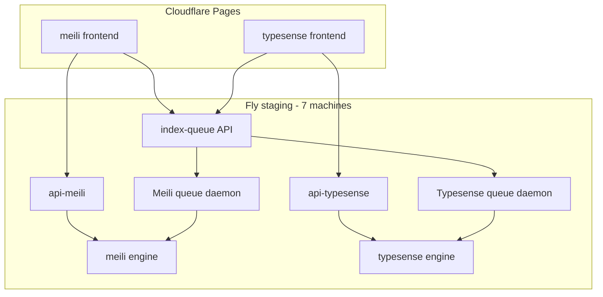

# Staging Architecture

This doc explains what runs in Fly staging, why there are seven machines, and how indexing stays reliable.

## The seven always-on units

Staging has two isolated indexers, one for each backend:

| # | Fly app | Purpose | Keeps running? |
| --- | --- | --- | --- |
| 1 | `ytsearch-api-meili-staging` | Public search API for the Meili frontend | Yes (`min_machines_running = 1`) |
| 2 | `ytsearch-meili-staging` | Meilisearch engine + volume | Yes |
| 3 | `ytsearch-api-typesense-fly-staging` | Public search API for the Typesense frontend | Yes (`min_machines_running = 1`) |
| 4 | `ytsearch-typesense-staging` | Typesense engine + volume | Yes |
| 5 | `ytsearch-index-queue-staging` | Private queue API (`/api/index-requests`) + JSONL volume | Yes |
| 6 | `ytsearch-indexer-staging` / `ytsearch-queue-meili` | Meilisearch queue daemon + dedicated cache volume | Yes |
| 7 | `ytsearch-indexer-staging` / `ytsearch-queue-typesense` | Typesense queue daemon + dedicated cache volume | Yes |

Frontends live on Cloudflare Pages and are not Fly machines.

## What is *not* a separate machine

- **No per-backend indexer.** One daemon indexes both `meilisearch` and `typesense-fly`.
- **No second queue worker.** JSONL on a single volume; multiple daemons would race.
- **Bulk one-off index jobs** are ephemeral Machines in the same indexer app (`scripts/fly-run-cloud-indexer.sh`), not extra permanent units.

## Reliability rules (current)

1. **Meili and Typesense run as separate queue daemons**. Each daemon has one `QUEUE_TARGET_BACKEND` and a separate Fly volume, so a long pass in one backend does not ack or block the other backend's queue rows.
2. **One queue request per daemon loop** by default (`QUEUE_ONE_REQUEST_PER_PASS=1`) so daily list updates and other queued handles get turns.
3. **Queue priority** favors handles in `scripts/indexed-channels.txt` over ad-hoc bulk requests (for example a 1,700-video channel queued from the UI).
4. **Daily update runs before each daemon's queue pass** when due, not only after an entire queue item finishes.
5. **Search APIs stay warm** (`min_machines_running = 1`, autostop off) so frontends do not look dead while indexing continues.
6. **Structured queue events** (`component=cloud-queue-indexer`) go to stderr and best-effort Axiom for Grafana; search dashboards alone will not show indexing progress.

## Operator surfaces

| Task | Command |
| --- | --- |
| Machine inventory | `scripts/check-staging-machines.sh` |
| Per-channel backend + queue status | `scripts/check-indexed-channel-status.sh @handle` |
| Start both queue daemons | `scripts/fly-run-queue-indexers.sh` |
| Verify queue-daemon isolation | `scripts/check-queue-indexers.sh` |
| One-off list catch-up without stealing the daemon volume | `ONE_OFF_NO_VOLUME=1 BACKENDS=typesense-fly scripts/fly-run-cloud-indexer.sh scripts/indexed-channels.txt` |
| Refresh frontend channel counts | `scripts/refresh-all-backend-counts.sh` |

## Grafana expectations

- **Search panels** (`search_query` in Axiom): API latency, result sizes. Quiet while nobody searches.
- **Indexer panels** (`component=cloud-queue-indexer`): `queue_poll`, `index_request_started`, `index_request_completed`, `daily_update_backend_failed`.
- **Typesense engine metrics**: chunk growth on the engine machine, not the API wrapper.

If one backend's counts look flat, check that backend's queue daemon logs and target-specific queue depth first.

## Legacy / cleanup

- `ytsearch-api-pronsh-sandbox`: suspended legacy app, no machines.
- Unattached indexer volumes can appear after failed one-off runs; delete unused volumes in the Fly dashboard if they are not attached to a machine.
