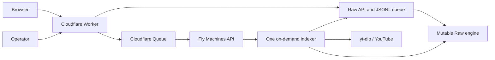

# Production architecture

Raw is the only target backend. Cloudflare serves the application, proxies the
Rust API, emits durable wake signals, and keeps the Raw engine running.

| Service | Purpose | Lifecycle |
| --- | --- | --- |
| Cloudflare Worker | Static app, same-origin API, availability, Fly control | Always available |
| Cloudflare Queue | Retryable indexer wake signal | Managed |
| `ytsearch-api-raw-production` | Public search API and authoritative JSONL request queue | Always running |
| `ytsearch-raw-production` | Reloadable inverted index and mutation publisher | Always on |
| `ytsearch-indexer-raw-production` | Approved indexing, daily update, and gap repair | On demand |

## Reliability rules

1. The API JSONL log is authoritative. Cloudflare Queue delivery may duplicate;
   a wake never represents the only copy of a request.
2. Exactly one indexer owns a queue file. Its Machine has restart policy `no`,
   exits after an idle window, and keeps its transcript-cache volume.
3. Every video write is an atomic, idempotent complete replacement. The CLI
   publishes once per creator/bulk batch instead of rebuilding per chunk.
4. Search stays on the last verified generation during publication. Candidate
   integrity/open failures leave durable mutations pending for retry.
5. Daily update and gap repair yield to approved requests. A persistent cursor
   prevents one unavailable creator/video from starving the list.
6. Caption fetches are paced and retry transient transport, timeout, 429, and 5xx
   failures. Exhausted IDs receive a six-hour cooldown by default.
7. The engine and API queue use separate Fly volumes and recovery checks.

## Availability and cost window

The Worker owns `GET /api/availability`. Production runs
`SEARCH_SCHEDULE_MODE=always_on` (`wrangler.jsonc`): a five-minute cron restarts
a stopped Raw engine, and search is available around the clock.

The optional `enforce` mode evaluates Pacific time. It prewarms the engine before noon, allows searches from noon through
midnight, stops the indexer first at close, then stops Raw on a later
reconciliation. Direct Raw auto-start is disabled so a request cannot bypass
the cost boundary.

The indexer Machine ID is discovered by the unique
`QUEUE_TARGET_BACKEND=raw` tag. The Raw engine Machine ID is explicit in
`wrangler.jsonc` so the Worker can never start or stop a benchmark Machine by accident.

## Publication state

The Raw volume contains:

- SQLite WAL operations and mutation payloads;
- an active-generation manifest;
- the active verified generation;
- one previous rollback generation;
- source corpus archives needed for compaction.

Admin counts include pending durable writes. Public search visibility advances
only when a verified generation becomes active. In the schema-6 era
(2026-08-08), full-corpus publication took 70–80 seconds and peaked at 2.46 GiB
RSS. The reader now runs schema-9 generations with a 2.5 GiB allocation sized
for publication double residency (`fly.raw-search.toml`); the release gate's
current memory limits are in
[Raw publication release](operations/raw-publication-release.md).

## Operator surfaces

| Task | Command |
| --- | --- |
| Deploy edge app | `bun run deploy:frontend` |
| Review requests | `scripts/review-index-requests.sh` |
| Machine inventory | `scripts/check-staging-machines.sh` |
| Queue invariant | `scripts/check-queue-indexers.sh` |
| Recreate/start indexer | `ON_DEMAND=1 scripts/fly-run-queue-indexer.sh` |
| Creator status | `scripts/check-indexed-channel-status.sh @handle` |
| Search benchmark | `RUNS=10 scripts/benchmark-search-cases.sh` |
