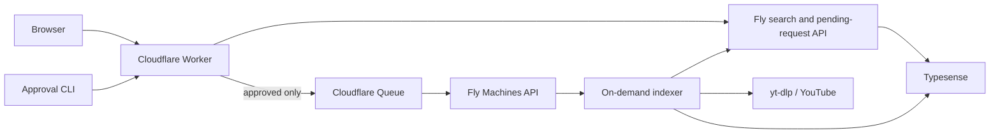

# Production Architecture

Typesense remains the search backend. Cloudflare serves the application and
uses a Queue message to wake the Fly indexer only after an operator approves a
frontend request.

| Service | Purpose | Keeps running? |
| --- | --- | --- |
| Cloudflare Worker | Static application, queue/status proxy, and approved-request wake producer | Yes |
| Cloudflare Queue | Durable, retryable indexer wake signal | Managed |
| `ytsearch-api-typesense-fly-staging` | Public search API and authoritative JSONL request queue | Yes |
| `ytsearch-typesense-staging` | Typesense engine and data volume | Yes |
| `ytsearch-indexer-staging` | Queue/indexing daemon and transcript cache | Only while work is active |

Production is served at `https://search.pronsh.dev`.

## Reliability And Cost Rules

1. The JSONL request log remains authoritative. Cloudflare Queue is only a wake
   signal, so duplicate delivery is harmless and losing an individual signal
   does not lose a request.
2. Keep exactly one configured indexer Machine because JSONL has no distributed
   lock. Its volume persists while the VM stops; it uses shared CPU with 8 GB
   RAM, `JOBS=1`, and `TYPESENSE_JOBS=1` while active.
3. The indexer has restart policy `no`, disables the legacy daily full refresh,
   and exits after five minutes with no queue or gap work. The Cloudflare
   consumer restarts it when a request is accepted and a six-hour cron wake
   lets it non-destructively close indexed/public video gaps while otherwise
   idle.
4. Public search and Typesense stay warm. Typesense uses four performance CPUs
   and 8 GB RAM: a live shared-CPU trial made cold-start recovery too slow. Keep
   the API separate because combining it saves very little while coupling public
   availability to Typesense restarts and memory pressure.
5. The indexer uses `yt-dlp` first. A YouTube Data API key is metadata discovery
   fallback only; it cannot retrieve transcript captions.
6. Update mode preserves existing chunks. Refresh indexed-count documents after
   a completed bulk pass so the frontend's `indexed / public` count stays true.
7. `TYPESENSE_RESET_PEERS_ON_ERROR=true` is single-node recovery behavior, not
   high availability. Investigate write pressure whenever it is needed.
8. Idle gap repair processes one creator at a time and rotates through a
   persistent cursor. Queue work is checked between creators and remains higher
   priority; `JOBS=1` preserves the single Typesense writer rule.

## Operator Surfaces

| Task | Command |
| --- | --- |
| Deploy the edge application | `bun run deploy:frontend` |
| Review index requests | `scripts/review-index-requests.sh` |
| Machine inventory | `scripts/check-staging-machines.sh` |
| Queue-worker invariant | `scripts/check-queue-indexers.sh` |
| Recreate/start the indexer | `ON_DEMAND=1 scripts/fly-run-queue-indexer.sh` |
| Per-channel status | `scripts/check-indexed-channel-status.sh @handle` |
| Refresh channel counts | `scripts/refresh-all-backend-counts.sh` |
| Search benchmark | `RUNS=10 scripts/benchmark-search-cases.sh` |
